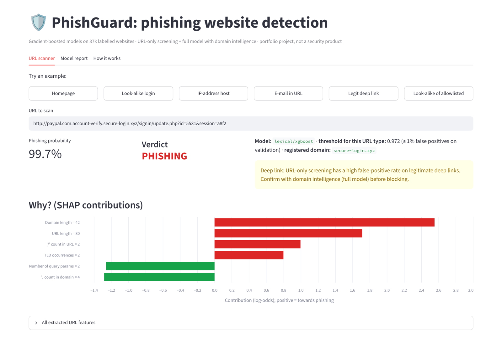
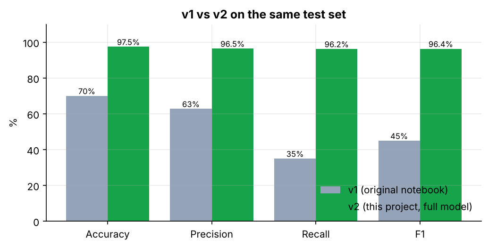
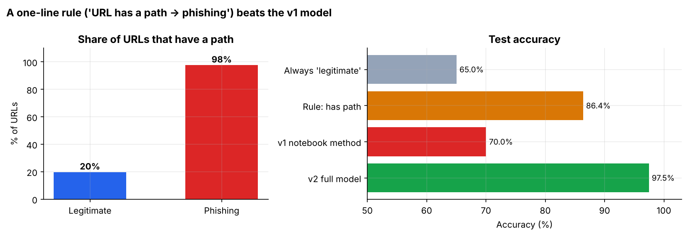
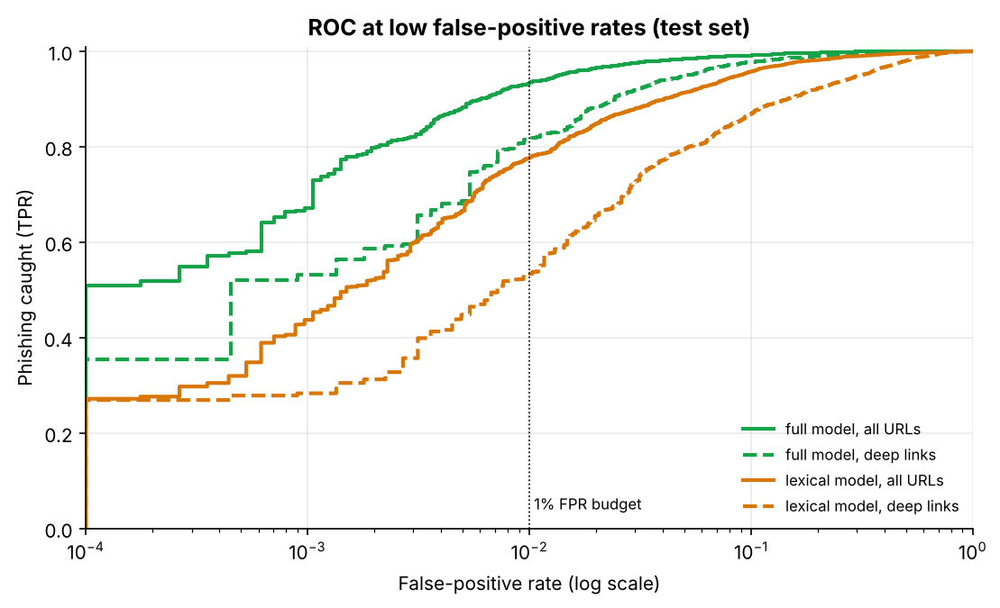
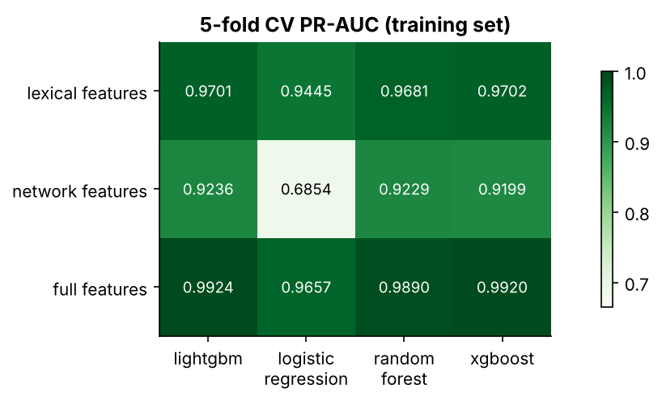
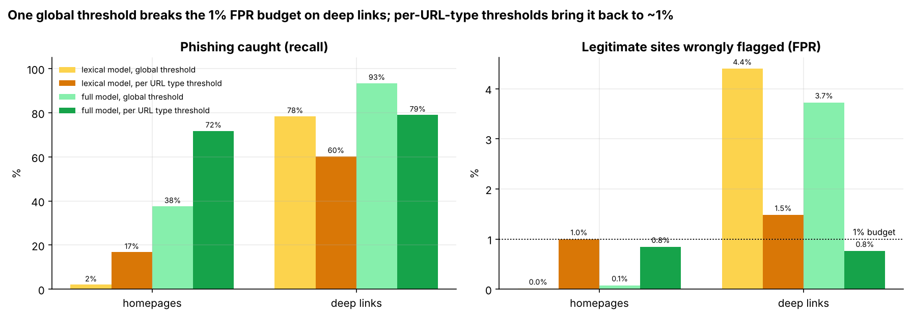
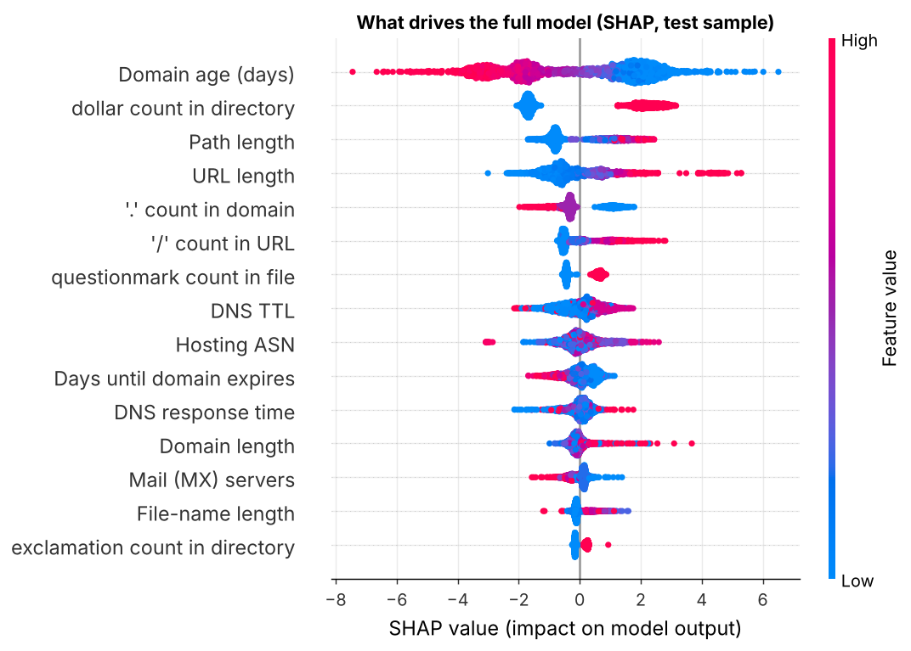
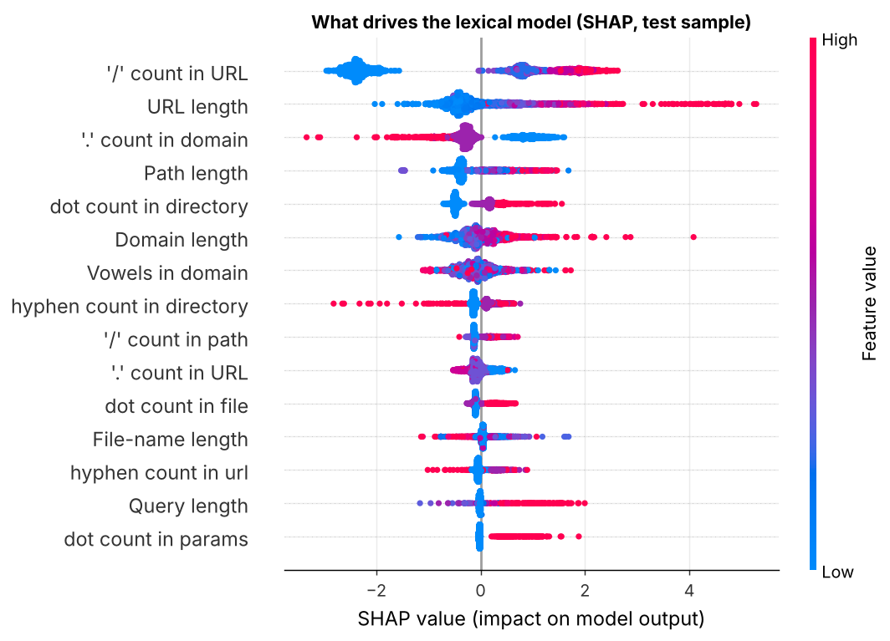

<div align="center">

# 🛡️ PhishGuard: Phishing Website Detection

### From a 71%-accuracy notebook to an evaluated, explainable detector, plus the dataset shortcut that makes most 97% results misleading


<!-- After pushing, replace YOUR-USERNAME to activate the CI badge:
 -->



</div>

---

## TL;DR

- **97.5% accuracy, ROC-AUC 0.996**: the full model (URL + domain-intelligence features) catches **93% of phishing
  sites at a 1% false-positive rate**.
- **But the dataset has a shortcut.** 80% of legitimate URLs are bare homepages while 98% of phishing URLs have a path.
  A one-line rule, "has a path → phishing", already scores **86% accuracy**.
- **Evaluated honestly on deep links**, a single global threshold breaks the 1% false-positive budget (**3.7–4.4%** real
  FPR). **Per-URL-type thresholds** fix this: the full model then catches **79% of phishing deep links at 0.8% FPR**.
- **URL-only screening** (no network look-ups) catches 60% of phishing deep links at ~1.5% FPR. It's useful as a first
  filter, not as a blocker. The scanner adds a **reputation allowlist** and flags deep links for confirmation.
- SHAP exposes the shortcut directly: the 2nd most important feature is the *"$ count in the path"*, which is really a hidden
  "URL has a path" flag.

> **v2 of my capstone project.** v1 reached 70.9% accuracy and 35% recall because its feature selection used the wrong
> column. See [what changed](docs/CHANGES_FROM_V1.md).

## 📌 Problem

Phishing sites imitate trusted brands to steal credentials. A detector is only useful if it rarely blocks legitimate
sites, so every model here is judged at a **fixed false-positive budget of 1%**, not by accuracy alone.

**Data:** [Vrbančič et al. (2020)](https://doi.org/10.1016/j.dib.2020.106438), 88,647 websites (58,000 legitimate,
30,647 phishing) × 111 features: character counts and lengths for each URL component (domain, path, file, query) and
domain-intelligence features (domain age, DNS, TLS, redirects). CC BY 4.0.

## 🔍 Key findings

### 1. v1 selected features using the wrong column
```python
selected_features = correlation_matrix[correlation_matrix['url_shortened'].abs() > 0.1].index   # v1
```
This keeps features correlated with **`url_shortened`**, not with the target. Only 3 survived. Re-running v1's
method on this project's test set reproduces its result: **70.0% accuracy, 35% recall**. v1 also called `drop_duplicates()`
without saving the result (1,438 duplicates stayed in), and `dropna()` found nothing because missing values are encoded as `-1`.

<p align="center"></p>

### 2. The dataset has a shortcut
<p align="center"></p>

The collection paired phishing *links* (which point to a specific fake page) with legitimate *domains*. People click
legitimate deep links all day, so every result below is also reported **separately for homepages and deep links**.

### 3. URL-only vs full model at a 1% false-positive budget
<p align="center">
  
  
</p>

| Test set (17,440 sites) | ROC-AUC | PR-AUC | Phishing caught @ 1% FPR | Accuracy @ 0.5 |
|---|---|---|---|---|
| v1 method | 0.711 | 0.591 | 10% | 70.0% |
| "Has a path" rule | n/a | n/a | n/a | 86.4% |
| **URL-only** (XGBoost, 98 features) | 0.982 | 0.972 | 78% | 93.9% |
| **Full** (LightGBM, 109 features) | **0.996** | **0.993** | **93%** | **97.5%** |

Gradient boosting beats logistic regression in every feature set (5-fold CV). Strong non-linear interactions matter here.

### 4. One threshold is not enough
<p align="center"></p>

| Full model | Homepages: caught / false alarms | Deep links: caught / false alarms |
|---|---|---|
| Global threshold (≤1% FPR overall) | 38% / 0.1% | 93% / **3.7%** ⚠️ |
| **Per-URL-type thresholds** | **72% / 0.8%** | **79% / 0.8%** ✅ |

The global threshold meets the 1% budget only *on average*, because easy homepages dominate the legitimate class.
Separate thresholds per URL type keep **both** segments within budget. A model trained **only** on deep links
reaches the same deep-link ROC-AUC (0.987 vs 0.988), so the full model has learned real signal beyond the shortcut.

### 5. What the model uses (SHAP)
<p align="center">
  
  
</p>

- **Domain age** is the strongest real signal: phishing domains are days or weeks old.
- The 2nd feature, **"$ count in directory"**, is almost never non-zero. It matters because it is `-1` for homepages
  and `0` for deep links, so it acts as a hidden "has a path" flag. Explainability caught the shortcut.
- URL-only model: number of `/`, URL length, and dots in the domain (sub-domain stuffing like `paypal.com.secure-login.xyz`).

## 🧰 What's in the box

| Component | Details |
|---|---|
| **URL feature extractor** | Turns a raw URL into the dataset's 98 lexical features. The extraction rules were reverse-engineered from identities that hold across the data (e.g. `length_url = domain + path + query`), and **property tests** enforce them |
| **Two models** | URL-only (instant, pre-click) and full (needs WHOIS/DNS/TLS), each with per-URL-type thresholds at ≤1% FPR |
| **Reputation layer** | Registered-domain allowlist (`data/allowlist.txt`), so `github.com/...` is trusted but `github.com.login-session.app` is scored |
| **FastAPI** | `POST /scan` (raw URL → verdict + SHAP reasons), `POST /score` (full feature vector), `/health`, `/model-info` |
| **Streamlit app** | URL scanner with example attacks, explanation chart and full evaluation report |
| **Notebook** | `notebooks/phishing_analysis.ipynb`: the full narrative with outputs |
| **Quality** | 37 tests, ruff, GitHub Actions (tests + smoke-train + Docker build), Docker Compose |

## 🗂️ Project structure

```
phishing-website-detection/
├── src/phishguard/
│   ├── data.py          # download, validation, cleaning report, feature groups
│   ├── url_features.py  # raw URL -> 98 lexical features (reverse-engineered conventions)
│   ├── modeling.py      # model zoo, -1 handling, split stratified by label x URL type
│   ├── evaluate.py      # TPR @ fixed FPR, threshold for an FPR budget
│   ├── explain.py       # SHAP per prediction
│   ├── plots.py         # report figures
│   ├── train.py         # every experiment end-to-end -> models/ + reports/
│   └── predict.py       # scan_url(): allowlist + model + per-type threshold
├── api/main.py          # FastAPI
├── app/streamlit_app.py # dashboard
├── notebooks/phishing_analysis.ipynb
├── models/              # lexical_model.joblib, full_model.joblib, metadata.json (thresholds)
├── reports/             # metrics.json, cv_results.csv, stratified_results.csv, figures/
├── data/                # sample/ (5k rows), allowlist.txt, raw/ (downloaded, git-ignored)
├── tests/               # extractor properties, pipeline, API
├── docs/                # MODEL_CARD.md, CHANGES_FROM_V1.md
└── Dockerfile · docker-compose.yml · Makefile · .github/workflows/ci.yml
```

## 🚀 Quickstart

```bash
git clone https://github.com/YOUR-USERNAME/phishing-website-detection.git
cd phishing-website-detection
python -m venv .venv && source .venv/bin/activate        # Windows: .venv\Scripts\activate
make setup                                               # or: pip install -r requirements-dev.txt && pip install -e .

make scan URL="http://paypal.com.account-verify.secure-login.xyz/signin/update.php?id=1"
make app          # dashboard  -> http://localhost:8501
make api          # API docs   -> http://localhost:8000/docs
make test         # 37 tests
make train        # re-run every experiment on the full dataset (~10 min, downloads 25 MB)
```

```bash
curl -X POST localhost:8000/scan -H "Content-Type: application/json" \
     -d '{"url": "http://github.com.login-session.app/auth"}'
```
```json
{
  "url": "http://github.com.login-session.app/auth",
  "registered_domain": "login-session.app",
  "phishing_probability": 0.8824,
  "verdict": "suspicious",
  "threshold": 0.9721,
  "model": "lexical/xgboost",
  "has_path": true,
  "note": "Deep link: URL-only screening has a high false-positive rate on legitimate deep links. Confirm with domain intelligence (full model) before blocking.",
  "top_reasons": ["..."]
}
```

## ⚠️ Limitations

- **Collection bias:** legitimate examples are mostly homepages, and the legitimate deep links in the data are not
  representative of everyday browsing. The URL-only model scores `docs.python.org/3/library/...` near 1, so its
  real-world false-positive rate on deep links is higher than measured. Hence the allowlist and the "confirm before
  blocking" note.
- **No raw URLs or dates in the dataset**: no time-based split (phishing evolves) and no grouping by domain.
- The extractor matches the documented conventions, but `qty_tld_url` and `tld_present_params` depend on an unknown
  TLD list and are approximate.
- The full model needs live WHOIS/DNS/TLS data. The API accepts those features, but the project doesn't collect them.

See the [model card](docs/MODEL_CARD.md) for intended use and risks.

## 📚 Reference

Vrbančič, G., Fister, I. Jr., & Podgorelec, V. (2020). *Datasets for phishing websites detection.* Data in Brief, 33,
106438. https://doi.org/10.1016/j.dib.2020.106438. Data: https://github.com/GregaVrbancic/Phishing-Dataset (CC BY 4.0)

## 👩‍💻 Author

**Ayushika Mishra** · [LinkedIn](https://www.linkedin.com/in/YOUR-PROFILE) · [GitHub](https://github.com/YOUR-USERNAME)
